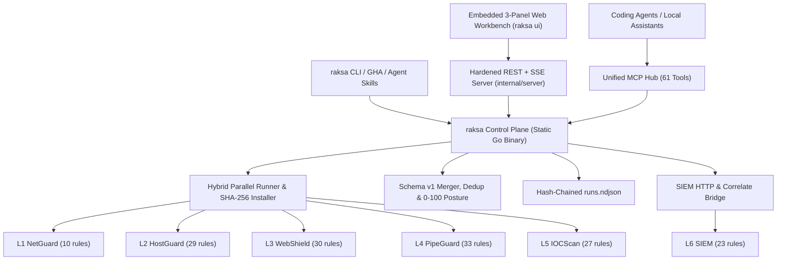

<div align="center">

# raksa

### Hybrid Defense-in-Depth Workbench & Blue Team Orchestrator (Layer 7)

Unifying network, host, web, DevSecOps, IoC/malware, and SIEM defenses (**152 built-in rules | 61 MCP tools | Embedded 3-Panel Web UI**) into one deterministic static binary.

[](https://github.com/luminariadev/raksa/actions/workflows/ci.yml)
[](https://github.com/luminariadev/raksa/actions/workflows/release.yml)
[](https://github.com/luminariadev/raksa/releases)
[](LICENSE)
[](go.mod)
[](docs/ARCHITECTURE.md)
[](docs/ARCHITECTURE.md)
[](docs/ARCHITECTURE.md)

</div>

---

**`raksa`** (from Sundanese/Sanskrit *raksa*, meaning to guard or protect) is the Layer 7 flagship umbrella orchestrator and workbench of the Raksa Security Suite. In **`v0.2.0`**, it combines a **clusterless, deterministic Go control plane** with an **embedded 3-panel Hybrid Web Workbench (`raksa ui`)**, unifying findings across Layers 1-6 into **Schema v1**, **SARIF 2.1.0**, **Markdown PR summaries**, **offline HTML executive reports**, and a federated **61-tool MCP Hub**.

## Why `raksa` Stands Out

- **Hybrid 3-Panel Workbench (`raksa ui`)**: Single-command `Full Audit (L1-L6)` paired with per-layer sidebar checkboxes, individual layer scans, YAML playbook triggers, `Ctrl+K` Command Palette, Attack-vs-Defense Matrix, Read-Only Diff Viewer, and live SSE telemetry embedded directly via `go:embed`.
- **Zero-Cluster & Offline-First Core**: No mandatory OpenSearch, PostgreSQL, Docker daemon, or LLM token burn to scan and correlate. History is persisted locally in a SHA-256 hash-chained ledger (`runs.ndjson`).
- **Hardened Local Web Security**: `raksa ui` enforces strict Content-Security-Policy (`default-src 'self'; script-src 'self'`), HSTS, `X-Frame-Options: DENY`, `HttpOnly; SameSite=Strict` token-to-cookie sessions, and same-origin anti-CSRF validation.
- **Federated 61-Tool MCP Hub**: One `raksa mcp` connection gives coding agents and assistants access to **8 orchestrator meta-tools** plus **53 specialized Layer 1-6 tools**.
- **Apache-2.0 Open-Core Architecture**: Individual and team orchestration stays 100% open source; clean `internal/ext` interfaces enable private compliance packs and fleet extensions via Go build tags.

---

## Hybrid Architecture



## Covered Defensive Ecosystem (Layers 1-6)

| Layer | Repository | Language | Rules | MCP Tools | Defensive Domain |
| :--- | :--- | :--- | ---: | ---: | :--- |
| **L1** | [raksa-netguard](https://github.com/luminariadev/raksa-netguard) | Go | `10` | `5` | Open-port baseline auditing, vertical/horizontal/distributed scan detection |
| **L2** | [raksa-hostguard](https://github.com/luminariadev/raksa-hostguard) | Rust | `29` | `9` | HMAC-signed event-driven FIM, Linux/SSH/systemd/Docker CIS & `fix-preview` |
| **L3** | [raksa-webshield](https://github.com/luminariadev/raksa-webshield) | Go + TS | `30` | `8` | HTTP headers, CSP/CORS/TLS audit, Nginx/Caddy/Ingress lint, semantic WAF sidecar |
| **L4** | [raksa-pipeguard](https://github.com/luminariadev/raksa-pipeguard) | Go | `33` | `9` | Secrets, CycloneDX/SPDX SBOM, OSV/KEV/EPSS CVEs, OCI image scan, IaC & CI |
| **L5** | [raksa-iocscan](https://github.com/luminariadev/raksa-iocscan) | Python | `27` | `10` | Pure-Python YARA engine, Imphash/FastCDC, PE/ELF/Mach-O, document & archive triage |
| **L6** | [raksa-siem](https://github.com/luminariadev/raksa-siem) | Go + Py | `23` | `12` | 13-format log normalizer, Sigma/EQL correlator, attack graph, hash-chained ledger |
| **L7** | **`raksa`** (This Repo) | Go | - | `+8` | Hybrid orchestrator, embedded 3-panel Web Workbench, YAML playbooks, **61-tool MCP Hub** |

---

## 30-Second Quickstart

### Build or Launch Embedded Web Workbench

```bash
# Build raksa from source (Go 1.24+)
go build -trimpath -o raksa ./cmd/raksa

# Launch the embedded 3-panel Hybrid Web Workbench on http://127.0.0.1:8787
./raksa ui --path .

# Or preview offline with included multi-layer fixtures
./raksa ui --from-reports ./testdata
```

### Hybrid CLI Scans & Executive Reporting

```bash
# Inspect installed tools, versions, and SHA-256 digests
raksa doctor

# Preview download URLs & SHA-256 checksums for Layer 1-6 tools
raksa install --dry-run

# Run Hybrid repository/DevSecOps profile across installed layers
raksa scan --path . --profile repo --format table --fail-on high

# Selective modular run on specific layers (graceful if others are absent)
raksa scan --path . --layers pipeguard,hostguard,siem --format sarif --output suite.sarif

# Aggregate upstream Schema v1 reports offline and generate standalone HTML report
raksa scan --from-reports ./testdata --format html --fail-on none --output suite.html

# Inspect tamper-evident run ledger & verify SHA-256 continuity
raksa posture --verify

# Preview read-only hardening diffs aggregated from L2/L3/L4
raksa fix-preview --path . --format diff

# Inspect built-in YAML playbooks and Attack-vs-Defense matrix
raksa playbooks list
raksa attack-matrix
```

---

## Federated 61-Tool MCP Server

Configure any stdio MCP client with:

```json
{
  "mcpServers": {
    "raksa": {
      "command": "raksa",
      "args": ["mcp"]
    }
  }
}
```

Orchestrator tools (`raksa_doctor`, `raksa_full_audit`, `raksa_posture_summary`, `raksa_correlate_all`, `raksa_defense_coverage`, `raksa_plan_remediation`, `raksa_list_playbooks`, `raksa_verify_history`) run directly in Go, while all 53 upstream `netguard_*`, `hostguard_*`, `webshield_*`, `pipeguard_*`, `iocscan_*`, and `siem_*` tools proxy cleanly to their respective `<tool> mcp` binary.

---

## GitHub Actions Usage

```yaml
- name: Run Raksa Hybrid Defense Gate
  uses: luminariadev/raksa/action@v0.2.0
  with:
    path: .
    profile: repo
    format: sarif
    fail-on: high
    output: raksa.sarif
```

## Documentation & Roadmap

- [Architecture & Hybrid Control Plane](docs/ARCHITECTURE.md)
- [Attack-vs-Defense Coverage Matrix](docs/ATTACK_VS_DEFENSE_MATRIX.md)
- [Open-Core & Enterprise Extension Model](docs/OPEN_CORE_MODEL.md)
- [Defensive Threat Model](docs/THREAT_MODEL.md)
- [Benchmarks & Verification Targets](docs/BENCHMARKS.md)
- [Changelog](CHANGELOG.md) | [Security Policy](SECURITY.md) | [Contributing](CONTRIBUTING.md)
